# Goodie Bag

**Download: [latest release](https://github.com/king-tulip999/Goodie-Bag---A-windows-tool-kit-for-sim-racing/releases)** (it's just one `GoodieBag.exe`, nothing to install)

I got sick of switching monitors, audio, fan curves and overlays by hand every time I went from my desk to my sim rig, so I spent the last year building one app that does it all. It sits in the tray, sets the PC up for whatever I'm doing, and has grown into the toolkit I use every time I race in iRacing. Now you get the chance to use it too!

## What's in it

Every feature is a plugin you can switch off, and when one's off it runs nothing in the background. There are themes (Light, Dark, OLED Pastel, or your own colors), and `Ctrl+F` searches every setting and keybind in the app.

### Window Profiles

Pick a program and give its window an exact size and spot: a game stretched across triple screens, held at a fixed resolution, or moved onto a side screen, with its borders removed. Presets cover your own displays, triple 1080p / 1440p / 4K and common window sizes. Profiles apply when the program starts (with a delay for games that resize themselves), with a keybind, from the tray or with one click, and groups move several programs at once. Scripts and a Stream Deck can apply them too, through Goodie Bag's command pipe.

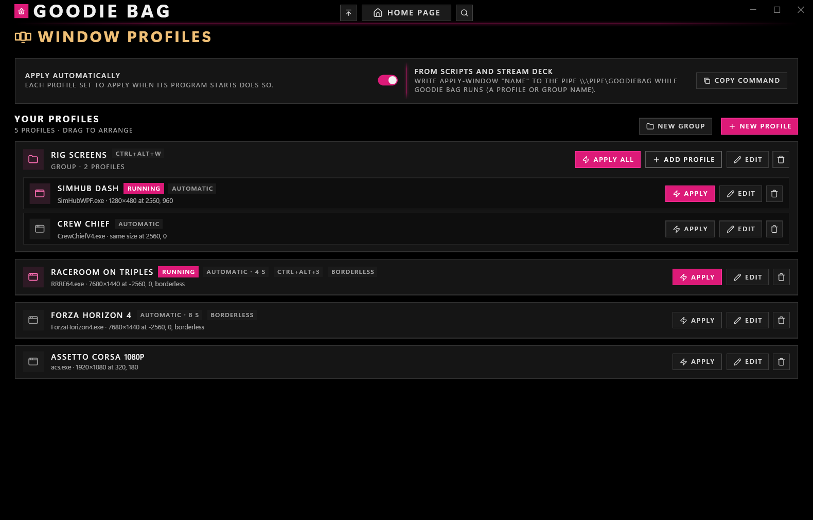

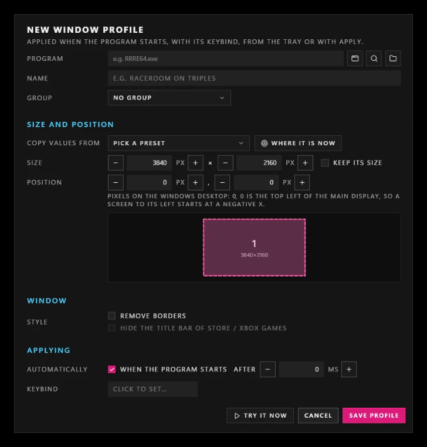

### Displays

Turn monitors on and off, arrange them, and set resolution, refresh rate, HDR, taskbar, wallpapers and audio. Save it all as profiles (mine are *Desk* and *Sim rig*) and switch between them with a hotkey.

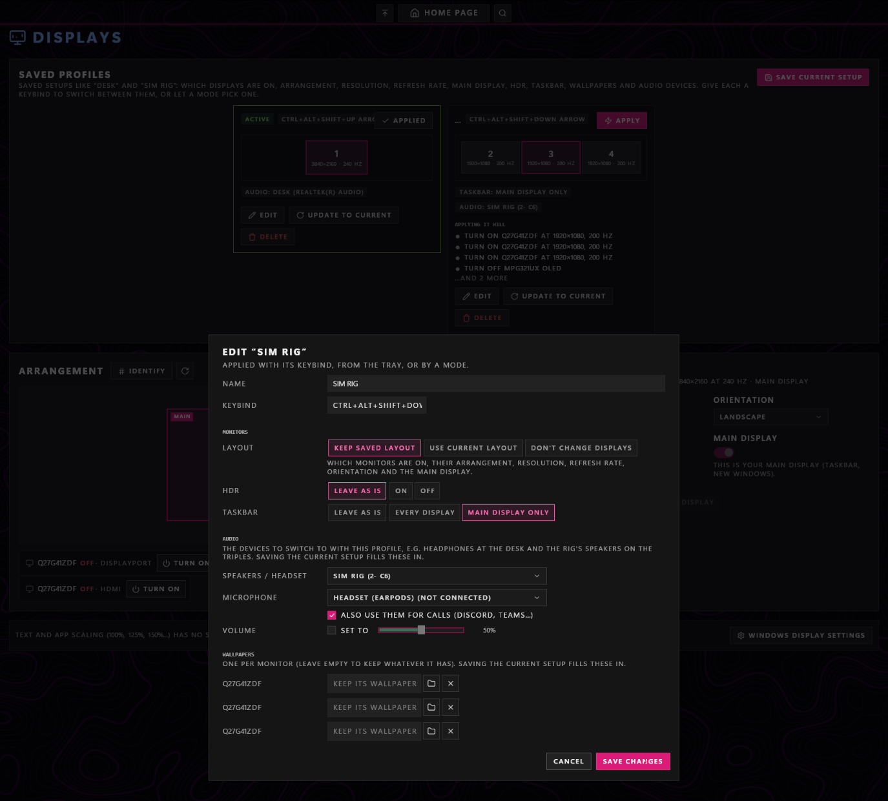

### Fan Control

Curves, presets, calibration and an emergency failsafe. Fans go back to the BIOS / driver when you quit.

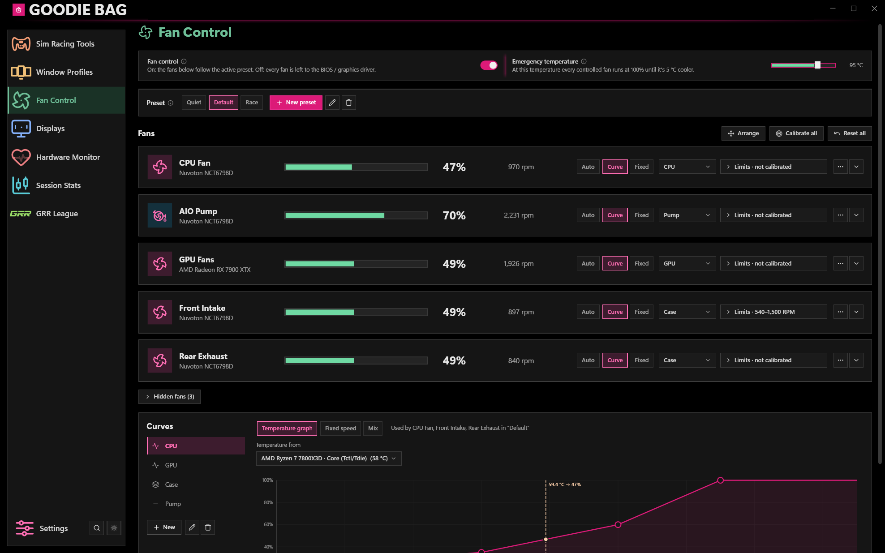

### Hardware Monitor

A dashboard of CPU, GPU, memory, network, storage, fans and frame rate, with every sensor your PC exposes. The **Performance Overlay** (FPS, 1% lows, temps, usage) lives here too, and you can drag things into whatever order you want.

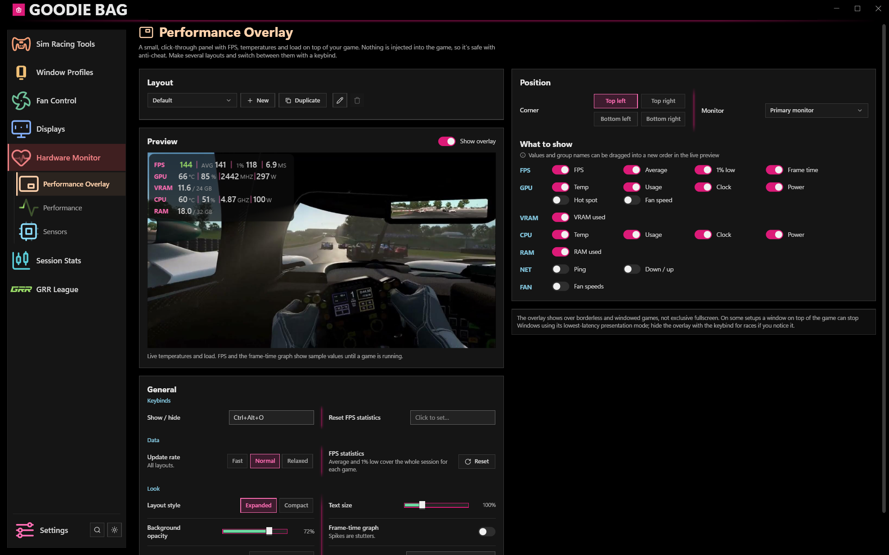

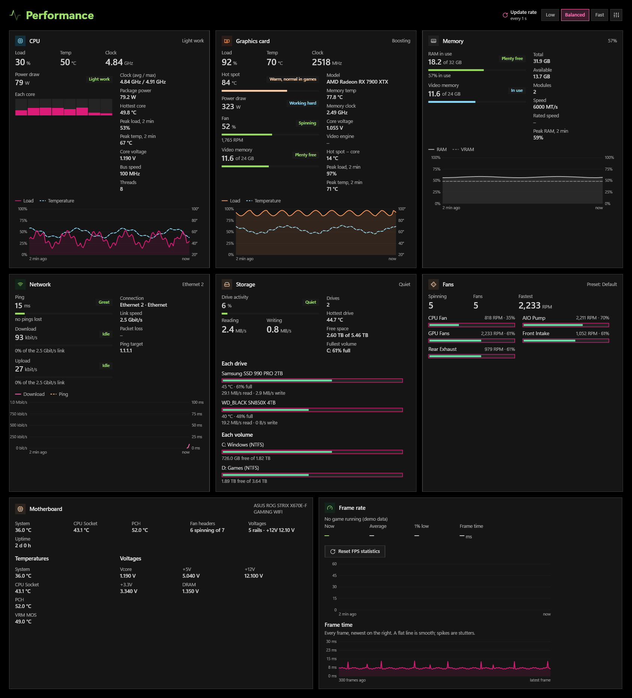

### Sim Racing Tools (iRacing)

#### iRacing Overlay

Relative, Standings, Fuel, Lap timing, Weather, Wind, Session, Race events, Multiclass traffic, Alerts and more. Every widget can be set up however you like, with layouts that switch by car / class / track, and an in-game editor (`Ctrl+Alt+E`) so you never have to leave the car.

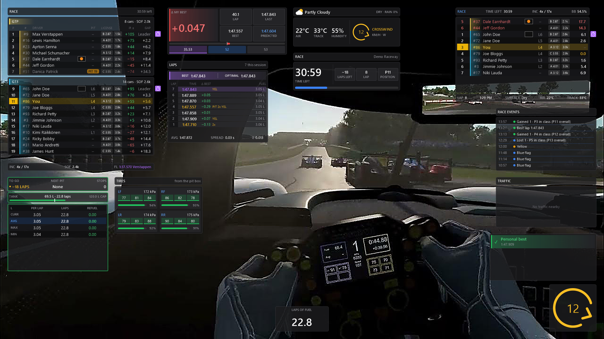

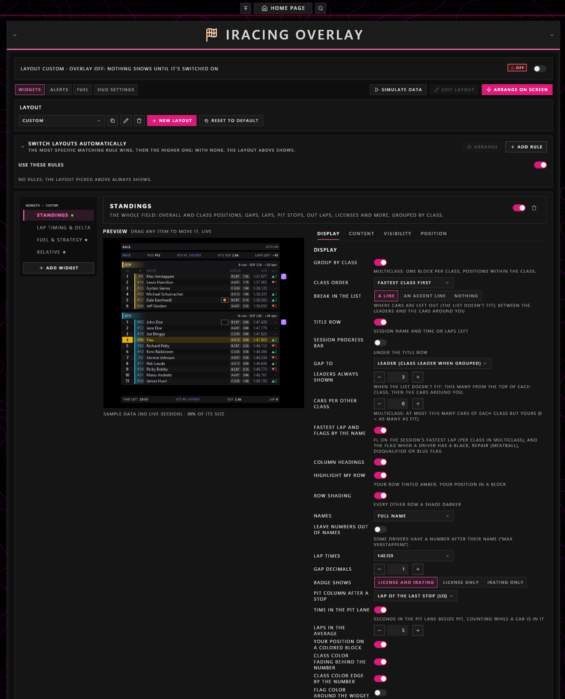

#### iRacing Setup Manager

All your setups sorted by car and class. Rename, move, import share packs and pick up new downloads.

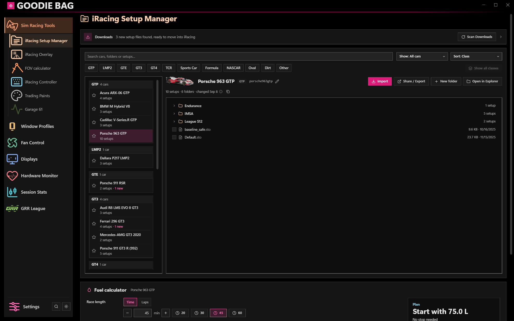

#### iRacing Controller

iRacing's settings in plain language, plus your in-sim keybinds per control profile. Everything gets backed up before it's changed.

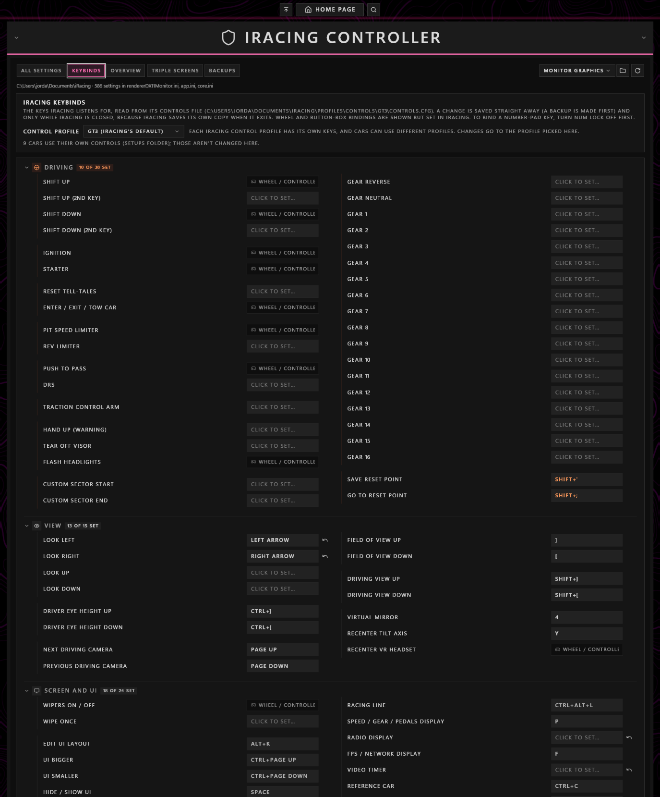

#### FOV Calculator

Single and triple screens, compare rigs, and write the result straight into iRacing.

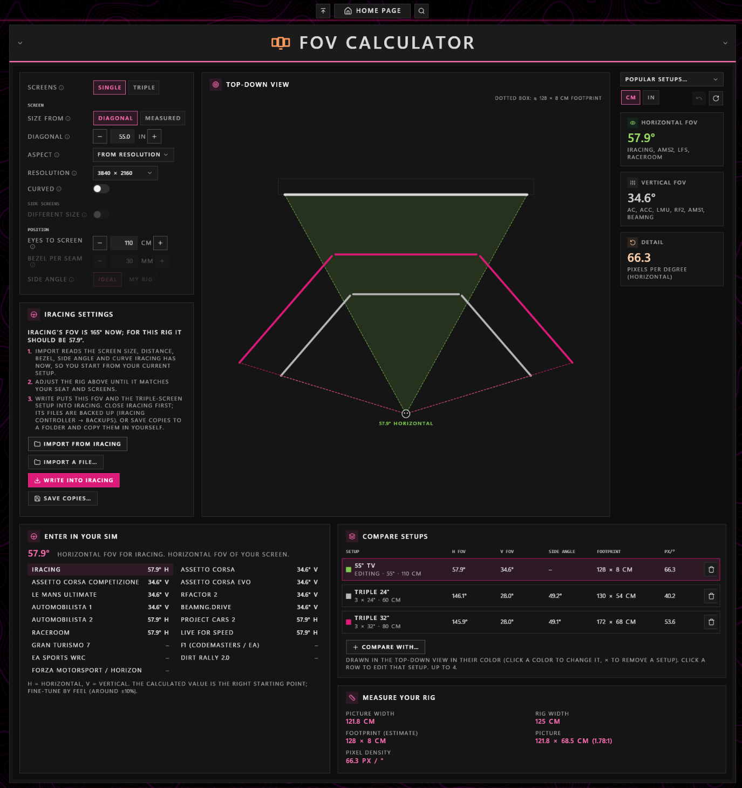

#### Trading Paints and Garage 61

Launch them with Goodie Bag or when iRacing starts.

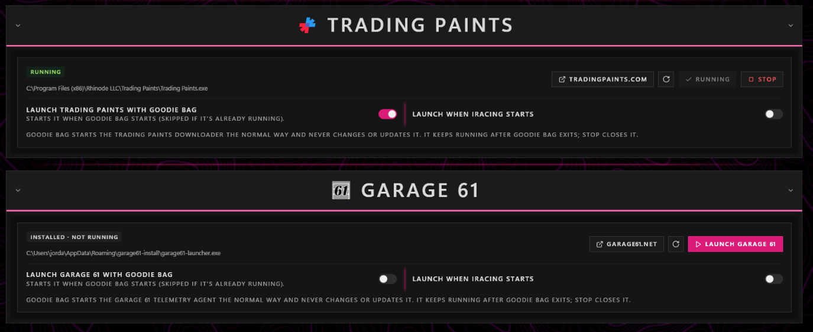

### Session Stats

Your iRacing history, kept on your PC. Laps, time, results, ratings, incidents and personal bests by week / month / season. Open any session for its laps and sectors, then compare laps on telemetry traces or a top-down replay. You can export a lap to share and import other people's. It also reads your old iRacing telemetry files, so your history doesn't start from zero.

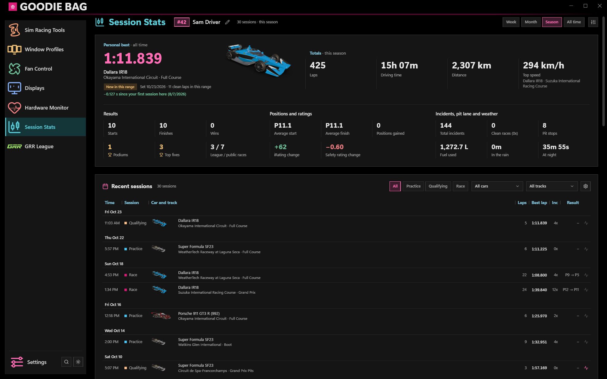

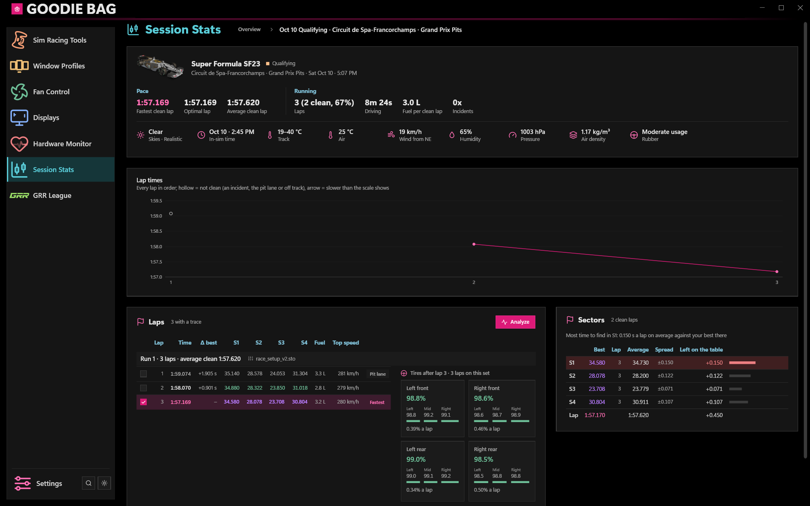

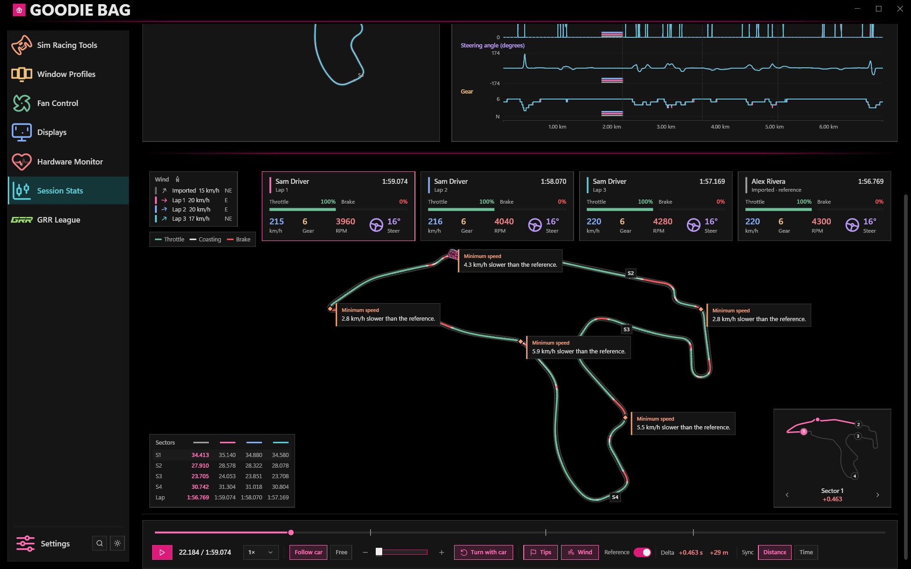

## Getting started

1. Download `GoodieBag.exe` and put it somewhere it can stay (e.g. `C:\Tools\GoodieBag`).
2. Run it. Windows will warn you twice (see below): SmartScreen (**More info → Run anyway**) and the administrator prompt (**Yes**).
3. The setup screen lets you pick a theme, which features you want, and startup options.
4. *Optional:* install the free **PawnIO** driver for CPU temperatures and motherboard fans (Settings → Hardware access → **Install PawnIO**).

Works on Windows 10 and 11 (x64).

## Before you run it

| Question | Answer |
| --- | --- |
| "Windows protected your PC"? | The exe isn't code-signed (certificates cost money every year). Click **More info → Run anyway**. If you want to check your copy, compare `Get-FileHash GoodieBag.exe` (PowerShell) with `GoodieBag.exe.sha256` on the release page. |
| Why administrator? | Frame counting, sensors, fan control, display changes and detecting games all need it. With **Start with Windows** on, it starts when you sign in without a prompt. |
| What is PawnIO? | A small, free, open-source, signed driver for CPU sensors and motherboard fans (it replaces WinRing0, which Defender flags). It's optional: without it CPU temperature shows *Not available* and motherboard fans can't be controlled. Everything else works. |
| Safe with anti-cheat? | Nothing gets injected into games. The overlays are separate click-through windows. If a strict anti-cheat ever complains about the driver, uninstall PawnIO. |
| Antivirus flagged it? | Unsigned admin apps that read hardware sometimes trip heuristics. If the checksum matches the release, it's the build I published. |
| What does it send online? | A small ping for the network readout (only while it's on screen), an update check against GitHub releases if you leave that on, and the GRR League feed if you turn that plugin on. No accounts, no telemetry. Your stats stay on your PC. |
| What does it change? | Only what you set up. iRacing files are always backed up first. Fans go back to BIOS / driver control when it quits. |

## Limitations

- The sim racing tools only support iRacing.
- Overlays show over borderless and windowed games, not exclusive fullscreen.
- If Goodie Bag gets force-killed (Task Manager → End task), fans stay at their last speed until it restarts or the PC reboots.
- Windows text scaling (100 %, 125 %…) has no supported API, so the Displays page just links to Windows settings for it.

## Updates and removal

- **Updates:** Settings → About & updates checks on start, daily, weekly or only when you click **Check now**. When there's an update, **Install and restart** downloads it, checks the checksum and swaps the exe. Your settings are kept.
- **Reset:** Settings → Data & configuration → **Reset Goodie Bag**. Your old settings are saved as `config.before-reset-<date>.json`, and **Export / Import** lets you back them up or move them to another PC.
- **Uninstall:** turn off **Start with Windows**, quit from the tray, then delete `GoodieBag.exe` and `%APPDATA%\GoodieBag`. If you installed PawnIO, remove it from Windows Settings → Apps.

## GRR League plugin

If you race in the GRR league, turn on the GRR League plugin (Settings → Plugins). It shows your next race, the championship, results and the schedule from the GRR website without leaving the app. It's off by default, so nobody else sees it.

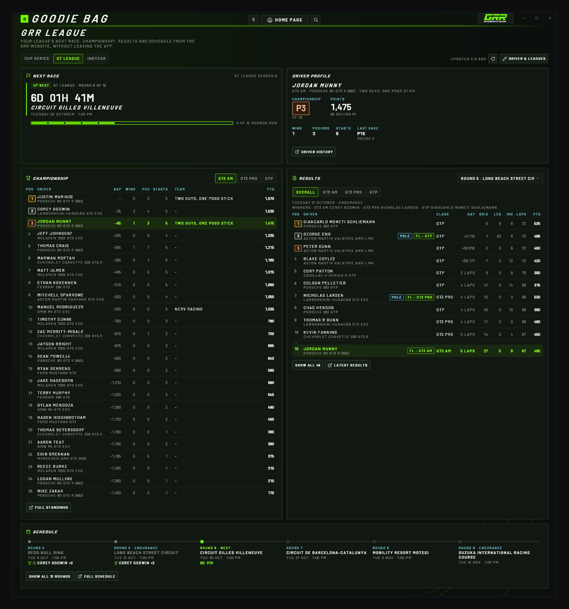

## Credits

Goodie Bag is built on these, each under its own licence:

| What | Used for | Licence |
| --- | --- | --- |
| [LibreHardwareMonitor](https://github.com/LibreHardwareMonitor/LibreHardwareMonitor) | Sensors and fan control | MPL 2.0 |
| [TraceEvent](https://github.com/microsoft/perfview) (Microsoft) | Frame counting for the FPS readouts | MIT |
| [.NET, WPF and Windows Forms](https://github.com/dotnet) (Microsoft) | The app framework | MIT |
| [Lucide](https://lucide.dev) | Icons (some adapted) | ISC |
| [Barlow](https://github.com/jpt/barlow) by Jeremy Tribby | GRR theme font | SIL Open Font License 1.1 |
| [webgl-noise](https://github.com/ashima/webgl-noise) by Ashima Arts and Stefan Gustavson | 3D simplex noise in the topography background | MIT |
| [SIMRacingApps](https://github.com/SIMRacingApps/SIMRacingAppsServer) by Jeffrey Gilliam | Track centreline and pit lane routes for the track map | Apache 2.0 |
| Track map drawings by [iRacing](https://www.iracing.com), collected in [racing-track-maps-vector](https://github.com/meowmachine/racing-track-maps-vector) by meowmachine | Track maps for Session Stats | © iRacing.com Motorsport Simulations, LLC |
| [Quotes-500K](https://github.com/ShivaliGoel/Quotes-500K) by Shivali Goel, Rishi Madhok and Shweta Garg | Quotes (from *Proposing Contextually Relevant Quotes for Images*, ECIR 2018) | Shared for educational and research use |
| [PawnIO](https://pawnio.eu) | Optional driver for CPU and motherboard sensors (not bundled; installed separately) | See its site |

Inspired by (no code or assets from these are used):

- [Fan Control](https://github.com/Rem0o/FanControl.Releases) by Rem0o: the Fan Control page
- [Resize Raccoon](https://github.com/mistenkt/resize-raccoon) by mistenkt and its fork [Resize Rabbit](https://github.com/rosscarlson/resize-rabbit) by rosscarlson: Window Profiles

Thanks to the [GRR League](https://www.grassrootsracing.org) for letting the GRR plugin use its site data and logo.

Full licence texts ship with the components (for example `NOTICES.md` inside the track map library and `Barlow-OFL.txt` beside the fonts).

iRacing is a trademark of iRacing.com Motorsport Simulations, LLC. Trading Paints and Garage 61 belong to their owners. Goodie Bag isn't affiliated with or endorsed by any of them.
